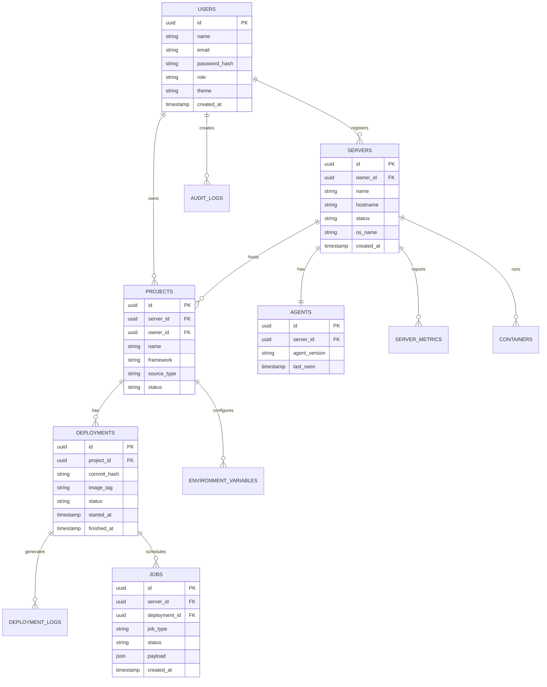

# PSM Database Design & Schema

The PSM Control Plane uses PostgreSQL managed via SQLAlchemy 2.0 ORM. All entities utilize UUID primary keys and timezone-aware UTC timestamps.

## Entity-Relationship Diagram

## Core Tables

1. `users`: System operators with Argon2id password hashes and role-based permissions (`owner`, `admin`, `operator`, `viewer`).
2. `user_sessions`: Active user sessions with SHA-256 hashed refresh tokens and IP addresses.
3. `servers`: Managed nodes with hardware architecture, OS, last seen timestamp, and online/offline status.
4. `agents`: Agent authentication credentials and versions.
5. `agent_tokens`: Cryptographically secure registration tokens for onboarding servers.
6. `projects`: Application projects mapped to target servers.
7. `project_sources`: Git repository branches or uploaded ZIP metadata.
8. `deployments`: Release records, version tracking, image tags, duration, and status.
9. `deployment_logs`: Append-only build and execution logs with sequence numbers.
10. `jobs`: Queue table using `FOR UPDATE SKIP LOCKED` for task dispatching.
11. `environment_variables`: Sensitive secrets encrypted with AES-Fernet.
12. `containers`: Inventory of running and stopped Docker containers.
13. `server_metrics`: Snapshots of CPU, memory, disk, network, and uptime.
14. `audit_logs`: Audit trail for security actions, logins, container restarts, and deployments.
